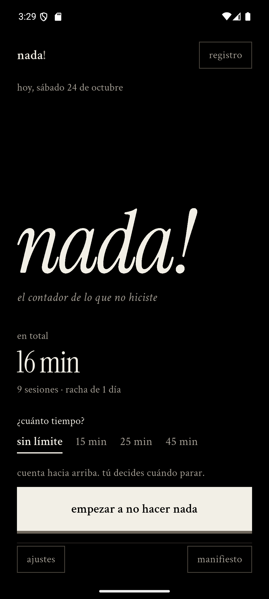
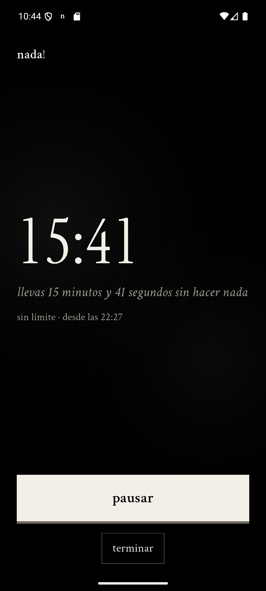

# nada!

> el contador de lo que no hiciste.

**nada!** es un cronómetro para el tiempo que no le debes a nadie. Un botón, un
número que crece y un registro que se acumula. Sin cuentas, sin nube, sin
notificaciones que te pidan hacer más. Negro, serif y en silencio.

No mide productividad. Mide presencia sin propósito.

<p align="center">
  
  
  
</p>

<p align="center"><sub>capturas reales del APK de release en un Pixel 8 con Android 16.</sub></p>

---

## Qué hace

- **Cronómetro libre.** Empieza en cero y cuenta hacia arriba todo lo que
  aguantes. No hay meta, no hay final, no hay culpa.
- **Metas de nada.** Tres tiempos rápidos editables, 15, 25 y 45 minutos por
  defecto. Cámbialos desde ajustes; la app te avisa cuando llegas, pero el
  tiempo sigue contando si decides quedarte.
- **Ajustes que ajustan.** Los tres tiempos se editan con teclado o con los
  steppers; el cambio se guarda al instante y aparece en la pantalla principal.
- **Un registro real.** Cada sesión se guarda con su duración, hora de inicio,
  hora de fin y modalidad. Nada se pierde si cierras la app o se muere el
  proceso.
- **El total de tu vida.** Cuánto tiempo llevas sin hacer nada, cuántas sesiones,
  racha de días y el detalle agrupado por día.
- **Notificación persistente.** Mientras no haces nada, el cronómetro vive en la
  barra de notificaciones de Android y sigue contando aunque la app esté en
  segundo plano.
- **Widget 2×2.** Tu nada acumulada en la pantalla de inicio, en negro o en
  blanco, con el tiempo en grande. Se actualiza al terminar una sesión.
- **Cero fricción.** Abres, tocas una vez, ya estás haciendo nada. El botón de
  empezar queda fijo abajo: nunca hay que buscarlo.
- **Claro sin onboarding.** La pantalla pregunta literalmente cuánto tiempo
  quieres y explica qué hace cada modo antes de que toques nada.
- **Legible de verdad.** Etiquetas de 16 px como mínimo, cuerpo de 18–21 px y
  acciones de 19 px. La tipografía no es decoración: es la interfaz.
- **Cero vigilancia.** Todo se guarda en tu teléfono. No hay login, analytics ni
  red.

## Capturas

Todas las capturas viven en [`docs/screenshots/`](docs/screenshots): inicio,
sesión libre, resumen, registro, ajustes, manifiesto, acerca de, la
notificación persistente y el widget en sus dos temas.

## Cómo se ve

La dirección visual es deliberada y no se parece a la de ningún timer del
mercado:

| Decisión | Por qué |
|---|---|
| Negro puro `#000000` | El vacío no es gris corporativo. En OLED, el fondo desaparece. |
| Hueso `#F2EFE6` | Un blanco cálido, de tinta y papel, no el blanco de una hoja de cálculo. |
| **Instrument Serif** | El número es el protagonista. Una serif editorial de alto contraste, con cursiva propia. |
| **Crimson Text** | Texto de libro, legible desde 16 px, con cursivas que susurran en vez de gritar. |
| Sin radios, sin sombras, sin gradientes | La jerarquía se construye con tipografía, espacio y líneas de 1 px. |
| Un solo elemento sólido | El botón principal es la única superficie blanca, con un relieve duro de 4 px para que se sienta pulsable. Todo lo demás es aire. |
| Acciones secundarias con borde | Registro, volver, ajustes, manifiesto, copiar y borrar son botones cuadrados de 1 px, no enlaces subrayados. |
| Duración en texto | `sin límite` y los minutos comparten una sola línea, sin cajas ni etiqueta “meta”; el activo se marca con subrayado. Los botones se reservan para las acciones. |
| Cero emojis, cero mayúsculas gritadas | El humor está en el copy, no en un icono. |
| El estado vacío dice **nada!**, no `00:00` | La firma de la app: el cero también es una palabra. |
| La pregunta antes que los botones | “¿Cuánto tiempo?” + las opciones en texto + una línea que explica el modo. |
| Acción siempre visible | El CTA vive en una franja fija abajo; el contenido respira y se desplaza solo si hace falta. |

El cronómetro usa ranuras de ancho fijo medidas con `TextPainter`, así que los
dígitos no tiemblan al cambiar de segundo. La transición de reposo a sesión es
el único momento coreografiado: el resto de la interfaz se retira y queda el
número.

La pantalla principal se lee de arriba a abajo como una página: la fecha, el
título, tu total, la pregunta y la acción. Nada compite por atención. Cuando
eliges “sin límite”, la app dice qué va a pasar; cuando eliges una meta, dice
cuándo te avisa. Esa línea de contexto es la diferencia entre adivinar y saber.

## Marca y tienda

El logo oficial, el icono de Play Store, el gráfico destacado, las capturas
9:16, la imagen de Open Graph y la ficha completa están en
[`store/`](store/). El wordmark es **solamente `nada!`** en una serif
editorial, hueso sobre negro; el icono usa el monograma `n!` para conservar
legibilidad a tamaño pequeño.

- `store/brand/nada-wordmark.svg` — logo vectorial oficial.
- `store/brand/icon-play-512.png` — icono de Play Store y launcher.
- `store/brand/widget-dark.png` y `widget-light.png` — previsualizaciones del widget.
- `store/feature-graphic-1024x500.png` — gráfico destacado.
- `store/screenshots/` — cinco capturas 1080×1920, incluida la del widget.
- `store/listing.md` — título, descripciones y notas de versión.
- `store/web/` — hero 1920×1080 y Open Graph 1200×630.

## Arquitectura

```
lib/
├── main.dart                     # entry point, orientación, edge-to-edge
├── app.dart                      # MaterialApp + ciclo de vida + inyección
├── core/
│   ├── nada_theme.dart           # color, tipografía, tema
│   └── nada_format.dart          # duraciones y fechas en español humano
├── data/
│   ├── nada_models.dart          # sesión, sesión activa, settings, stats
│   ├── session_repository.dart   # contrato + implementación local JSON
│   └── sync_service.dart         # contrato de sync + no-op + fila Supabase
├── services/
│   ├── nada_notifications.dart   # notificación nativa con cronómetro
│   └── nada_widget_service.dart  # puente Flutter ↔ widget de Android
├── state/
│   ├── nada_controller.dart      # cerebro: tiempo, ledger, persistencia
│   └── nada_scope.dart           # InheritedNotifier, sin dependencias
└── ui/
    ├── nada_shell.dart           # cambio de pantalla con crossfade
    ├── home_view.dart            # el estado vacío y el botón
    ├── session_view.dart         # el cronómetro en curso
    ├── summary_view.dart         # el cierre de una sesión
    ├── history_screen.dart       # el registro y el detalle
    ├── settings_sheet.dart       # ajustes mínimos
    ├── manifesto_screen.dart     # la filosofía del vacío
    ├── layout.dart               # marco, header, rutas
    └── widgets/nada_widgets.dart # botón, reloj, toggle, elecciones
```

### Decisiones técnicas

- **Tiempo por timestamp, no por ticks.** La sesión guarda `lastResumedAt` y
  `accumulated`; el tiempo mostrado se calcula con `DateTime.now()`. Un tick
  perdido, una app en segundo plano o un proceso muerto no alteran el total.
- **El reloj repinta solo.** `NadaController.elapsed` es un `ValueNotifier` que
  solo escucha el héroe. Las estadísticas, el header y los botones no se
  reconstruyen cada segundo.
- **Persistencia en un solo documento JSON** (`nada.json` en el directorio de
  soporte de la app), con escritura atómica (`tmp` + rename). Se escribe solo en
  start / pause / resume / finish, nunca en cada tick.
- **La notificación no la actualiza Dart.** Android renderiza el cronómetro
  nativo (`usesChronometer`), así que sigue corriendo aunque el isolate esté
  congelado. La app solo muestra/oculta la notificación en los cambios de
  estado.
- **El aviso de meta se programa solo al pasar a segundo plano.** Si la app está
  abierta, el resumen en pantalla es el aviso; así no hay doble notificación.
- **Recuperación al volver.** Si una meta venció mientras la app estaba cerrada,
  se cierra exactamente en el minuto de la meta, no cuando vuelves.
- **Sin dependencias de estado.** `InheritedNotifier` + `ValueNotifier`; no hay
  Provider, Riverpod ni Bloc que cargar en el arranque.
- **Fuentes empaquetadas.** Instrument Serif y Crimson Text viven en
  `assets/fonts/`; no hay descarga en runtime ni primer frame con fuente
  equivocada.
- **Cero red.** La app no declara `INTERNET` en el manifiesto.
- **El ícono de la notificación sobrevive a R8.** Android lo resuelve por
  nombre en runtime, así que el optimizador de recursos lo eliminaría. Está
  referenciado estáticamente en el manifiesto (`NOTIFICATION_ICON`) y en
  `res/raw/keep.xml`.
- **Las rutas empujadas llevan un `Material` propio.** Sin ese ancestro,
  Flutter pinta el texto con su estilo de fallback (amarillo y subrayado); es
  fácil de confundir con un bug de diseño. La primera versión de las pantallas
  de registro y manifiesto lo demostró.
- **Probado en release, no solo en debug.** El cronómetro de la notificación,
  el permiso de Android 13+, la muerte de proceso y la restauración por
  timestamp se verificaron en un APK de release sobre Android 16.

## Correr la app

```bash
flutter pub get
flutter run -d emulator-5554
```

Requisitos: Flutter 3.38+ (probado en 3.47.7), Android SDK 37 para compilar por
`flutter_local_notifications` 22.

```bash
flutter test          # 18 tests: formato, stats, controlador, presets, widget
flutter analyze       # limpio
flutter build apk --release
```

El APK queda en `build/app/outputs/flutter-apk/app-release.apk`.

## Cómo activar el premium (sync en la nube)

La app ya está partida en dos mitades: el **ledger local** y un `SyncService`
que hoy es un no-op. El controlador llama a `SyncService.onLocalChange()` en
cada cambio real, así que conectar la nube no toca ni la UI ni las reglas del
contador.

**Recomendación de costo:** Supabase en su plan gratuito es más que suficiente
para un registro de sesiones de texto (cientos de MB darían para millones de
sesiones). Alternativas igual de baratas: PocketBase auto-hospedado, Turso,
Cloudflare D1 o Appwrite. Firebase también tiene un free tier, pero acopla el
proyecto a Google y complica la exportación.

### Camino recomendado

1. Crea un proyecto en Supabase y ejecuta `supabase/schema.sql`.
2. Activa **Anonymous Sign-Ins** en Authentication. Cada dispositivo obtiene un
   usuario sin pedir email; al comprar premium, se vincula un email para
   recuperar el registro en otro teléfono.
3. Añade `supabase_flutter` y crea `SupabaseSyncService implements SyncService`.
4. En `main.dart` / `app.dart`, inyecta el servicio en `NadaController`.
5. El plan gratuito sigue funcionando sin cuenta: el premium solo enciende la
   sincronización.

Detalles, esquema SQL y política de conflictos en
[`docs/premium-supabase.md`](docs/premium-supabase.md).

### Modelo de negocio sugerido

- **Gratis para siempre:** contador, registro local ilimitado, stats, export
  manual.
- **Premium (suscripción o pago único):** sync entre dispositivos, backup,
  exportación CSV/JSON, widgets, temas tipográficos, "modo avión" (bloquear
  apps durante una sesión) y Live Activities en iOS.
- **Sin ads, sin venta de datos.** La promesa de privacidad es parte del
  producto; el premium se paga por continuidad, no por quitarte algo.

## Por qué puede competir

| | nada! | usenothing.com | Pomodoro apps | Forest / focus apps |
|---|---|---|---|---|
| Registro acumulado de por vida | **Sí** | No | Parcial | Parcial |
| Cuenta y nube | **No** | No | A veces | Sí |
| Cronómetro libre + meta | **Sí** | Solo countdown | Solo countdown | Solo countdown |
| Diseño editorial real | **Sí** | Minimal web | Genérico | Gamificado |
| Notificación nativa persistente | **Sí** | N/A | A veces | Sí |
| Sin gamificación ni culpa | **Sí** | Sí | No | No |
| Costo de infraestructura | **0** | 0 | — | — |

El foso no es una función: es la combinación de una identidad visual que se
recuerda, un registro que se vuelve valioso con el tiempo y una fricción de
uso casi nula. La retención viene del total, no de una racha que te castiga.

## Roadmap

- Widget de pantalla de inicio con el total y un botón de start.
- Exportar el registro (CSV / JSON) desde ajustes.
- Sync premium con Supabase + backup.
- Live Activities / Dynamic Island en iOS.
- Versión Apple Watch: un botón, nada más.
- Modo "silencio": bloquear apps durante una sesión (Android).

## Créditos

- Tipografías: [Instrument Serif](https://fonts.google.com/specimen/Instrument+Serif)
  y [Crimson Text](https://fonts.google.com/specimen/Crimson+Text), SIL Open
  Font License.
- Hecho con Flutter. Sin frameworks de estado, sin analytics, sin prisa.
- Ernesto Flames (DOSe) · MIT.

---

<p align="center"><sub>no hacer nada también es una forma de estar completo.</sub></p>
