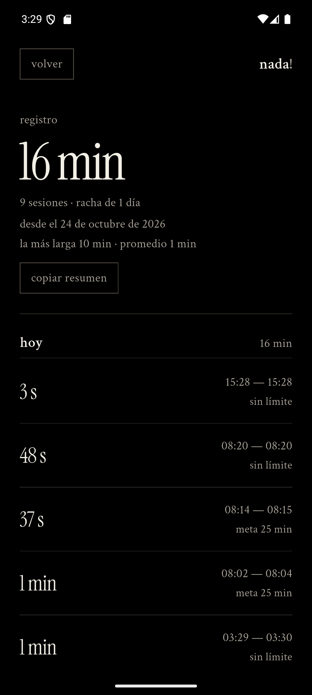

# nada!

> la app para hacer... nada. o algo. depende.

**nada!** es un contador para hacer algo productivo o no. Eliges un tiempo,
inicias y el registro se acumula. Sin cuentas, sin nube y sin nadie mirando.

No es una app de productividad. Es una app de presencia. La productividad es tu
problema.

Este repositorio contiene el producto completo, en dos clientes que comparten
marca, copy, reglas de tiempo y estructura de datos:

- **`app/`** — la app de Android, escrita en Flutter.
- **`web/`** — la versión web de escritorio, HTML, CSS y JavaScript sin
  frameworks.

**Web:** [nada.isdose.com](https://nada.isdose.com)

<p align="center">
  
  
  
</p>

<p align="center"><sub>capturas reales del APK de release en un Pixel 8 con Android 16.</sub></p>

---

## Qué hace

- **Cronómetro libre.** Empieza en cero y cuenta hacia arriba. Tú decides
  cuándo parar de no hacer nada.
- **Tres presets con nombre.** Pomodoro, jornada y maratón: 25, 45 y 90 minutos
  por defecto. El nombre no cambia; los minutos sí.
- **Un registro real.** Cada sesión se guarda con duración, hora de inicio,
  hora de fin y modalidad. Sobrevive a un recargado, a un cierre de app y a la
  muerte del proceso.
- **El total de tu vida.** Cuánto tiempo llevas sin hacer nada, cuántas
  sesiones, racha de días y detalle agrupado por día.
- **Medallas de nada.** Una por cada 45 minutos. La semana empieza el lunes y
  las que ya ganaste se quedan en tu colección. No sirven para nada.
- **Pausa física.** El cronómetro se congela, la luz de fondo se detiene y el
  botón principal se hunde hasta que continúas.
- **Sonido al terminar.** Un chime corto de dos notas. Se puede desactivar en
  ajustes o probar desde ahí.
- **Cero vigilancia.** No hay login, analytics ni peticiones a terceros.

La app añade lo que el navegador no puede prometer: notificación persistente
con cronómetro nativo, widget 2×2 en la pantalla de inicio y aviso de meta en
segundo plano.

## Dos clientes, una nada

| | `app/` (Android) | `web/` |
|---|---|---|
| Cronómetro, presets y medallas | Sí | Sí |
| Registro, racha y total acumulado | Sí | Sí |
| Notificación persistente | Sí | No |
| Widget 2×2 | Sí | No |
| Aviso de meta en segundo plano | Sí | No |
| Instalación | APK / Play Store | Abrir una URL |
| Dónde vive el registro | `nada.json` privado de la app | `localStorage` |
| Permiso de internet | No | El del navegador |

La app no declara `INTERNET` en el manifiesto: el enlace a la web abre el
navegador del sistema, no una petición de la app.

## Cómo se ve

La dirección visual es la misma en las dos: negro puro, hueso, serif editorial
y humor seco. La app es vertical y de un solo gesto; la web es editorial y de
escritorio.

| Decisión | Por qué |
|---|---|
| Negro puro `#000000` | El vacío no es gris corporativo. En OLED, el fondo desaparece. |
| Hueso `#F2EFE6` | Un blanco cálido, de tinta y papel. |
| **Instrument Serif** | El número es el protagonista. Serif editorial de alto contraste. |
| **Crimson Text** (app) y **Source Serif 4** (web) | Texto de libro, legible desde 16 px. |
| Sin radios, sin sombras suaves, sin gradientes de relleno | La jerarquía se construye con tipografía, espacio y líneas de 1 px. |
| Un solo elemento sólido | El botón principal es la única superficie clara, con relieve duro de 4 px. |
| Acciones secundarias con borde | Botones cuadrados de 1 px, no enlaces subrayados. |
| Presets con nombre y minutos | `sin límite`, `pomodoro`, `jornada` y `maratón` dicen lo que ocurrirá antes de iniciar. |
| Medallas tipográficas | Un sello `n!` cuadrado, invertido cuando está ganado. |
| El estado vacío dice **nada!**, no `00:00` | La firma del producto: el cero también es una palabra. |
| Movimiento reducido | La luz de sesión es tenue, se detiene al pausar y respeta `prefers-reduced-motion`. |
| Cero emojis, cero mayúsculas gritadas | El humor está en el copy, no en un icono. |
| Cero red | Las fuentes se sirven desde el proyecto; no hay fuentes remotas. |

El cronómetro usa ranuras de ancho fijo (`TextPainter` en la app, `ch` en la
web) para que los dígitos no tiemblen al cambiar de segundo. El tiempo se
calcula con marcas de tiempo, no restando un segundo por tick: una pestaña
dormida, una app en segundo plano o un recargado no alteran el total.

## Estructura

```
nada/
├── app/                        # la app de Android (Flutter)
│   ├── lib/
│   │   ├── main.dart           # entry point, orientación, edge-to-edge
│   │   ├── app.dart            # MaterialApp + ciclo de vida + inyección
│   │   ├── core/               # tema y formato de duraciones en español
│   │   ├── data/               # modelos, repositorio local y contrato de sync
│   │   ├── services/           # notificación nativa, widget, enlace a la web
│   │   ├── state/              # controlador y scope sin dependencias
│   │   └── ui/                 # pantallas y widgets
│   ├── android/                # proyecto Android (widget 2×2, chime, notificación)
│   ├── assets/fonts/           # Instrument Serif + Crimson Text (SIL OFL)
│   ├── test/                   # formato, stats, presets, medallas, controlador
│   ├── docs/screenshots/       # capturas reales del APK
│   ├── store/                  # kit de marca, capturas y ficha de Play
│   └── tool/                   # release, bump de versión, iconos, assets
├── web/                        # la versión web
│   ├── index.html              # vistas, diálogos y contenido
│   ├── style.css               # el sistema visual completo
│   ├── script.js               # estado, cronómetro, registro y persistencia
│   ├── fonts/                  # Instrument Serif + Source Serif 4 (SIL OFL)
│   └── images/                 # icono, wordmark y Open Graph
├── CHANGELOG.md
├── LICENSE
└── README.md
```

## Correr la web

No hay build ni dependencias. Sirve el directorio:

```bash
python -m http.server 8080 --directory web
```

Luego visita `http://localhost:8080`. El servidor local es recomendable para
que el portapapeles funcione en todos los navegadores.

## Correr la app

```bash
cd app
flutter pub get
flutter run -d emulator-5554
```

Requisitos: Flutter 3.38+ (probado en 3.47.7), Android SDK 37 para compilar por
`flutter_local_notifications` 22.

```bash
cd app
flutter test          # formato, stats, presets, medallas, controlador, aviso
flutter analyze       # limpio
flutter build apk --release
```

### Versión y build

Cada release sube el último número de la versión (`1.0.1`, `1.0.2`…) y el build
code de Android. El wrapper lo hace todo:

```powershell
powershell -ExecutionPolicy Bypass -File app\tool\release.ps1
```

El script incrementa `app/pubspec.yaml`, sincroniza `app/lib/core/app_info.dart`,
compila el release y deja copias de `nada-<versión>.apk` en el Escritorio y en
Descargas, con su SHA-256. Para un cambio de minor o major:

```powershell
powershell -ExecutionPolicy Bypass -File app\tool\release.ps1 -Part minor
```

## Cómo se guarda

**App:** un solo documento JSON (`nada.json`, en el directorio de soporte de la
app) con escritura atómica (`tmp` + rename). Se escribe solo en
start / pause / resume / finish, nunca en cada tick.

**Web:** `localStorage` bajo la clave `nada.web.v1`:

- `sessions`: lista de sesiones terminadas.
- `active`: sesión en curso, con `startedAt`, `lastResumedAt` y `accumulatedMs`.
- `settings`: los tres presets, el modo, la meta y el sonido.

En los dos casos, si cierras con una sesión corriendo, al volver se calcula el
tiempo real transcurrido. Si la meta se cumplió mientras estabas fuera, la
sesión se cierra exactamente en la meta, no cuando vuelves.

Nada sale de tu dispositivo.

## Decisiones técnicas

- **Tiempo por timestamp, no por ticks.** La sesión guarda `lastResumedAt` y
  `accumulated`; el tiempo mostrado se calcula con `DateTime.now()`. Un tick
  perdido o un proceso muerto no alteran el total.
- **El reloj repinta solo.** `NadaController.elapsed` es un `ValueNotifier` que
  solo escucha el héroe. Las estadísticas y los botones no se reconstruyen cada
  segundo.
- **La notificación no la actualiza Dart.** Android renderiza el cronómetro
  nativo (`usesChronometer`), así que sigue corriendo aunque el isolate esté
  congelado.
- **El aviso de meta se programa solo al pasar a segundo plano.** Si la app está
  abierta, el resumen en pantalla es el aviso.
- **Sin dependencias de estado.** `InheritedNotifier` + `ValueNotifier`; no hay
  Provider, Riverpod ni Bloc que cargar en el arranque.
- **El ícono de la notificación sobrevive a R8.** Está referenciado
  estáticamente en el manifiesto (`NOTIFICATION_ICON`) y en `res/raw/keep.xml`.
- **Las rutas empujadas llevan un `Material` propio.** Sin ese ancestro, Flutter
  pinta el texto con su estilo de fallback (amarillo y subrayado).
- **Probado en release, no solo en debug.** El cronómetro de la notificación, el
  permiso de Android 13+, la muerte de proceso y la restauración por timestamp se
  verificaron en un APK de release sobre Android 16.
- **La web no tiene build.** HTML, CSS y JavaScript del navegador, sin bundler,
  sin `node_modules` y sin paso de compilación.

## Changelog

Cada cambio u opción nueva se anota aquí al implementarla; el historial completo
está en [`CHANGELOG.md`](CHANGELOG.md). Lo más reciente va arriba.

### 1.0.5

- Presets con nombre: **pomodoro 25**, **jornada 45** y **maratón 90**, con
  minutos editables y migración única desde 15/25/45.
- **Medallas de nada:** una por cada 45 minutos, contador semanal desde el lunes
  y colección histórica.
- Copy nuevo, más seco: *la app para hacer... nada. o algo. depende.* El
  manifiesto pasa a llamarse *el arte de no hacer nada*.
- El botón secundario de sesión y resumen ocupa el ancho completo.
- La web se rediseña para escritorio con el mismo registro, presets y medallas.
- App y web se unifican en un solo repositorio: `app/` y `web/`.

### 1.0.4

- Enlace a la versión web desde “acerca de nada!”.
- La web comparte marca, tipografías, flujo y registro con la app.

### 1.0.3

- La notificación persistente deja de congelarse en “quedan 46 s”: muestra la
  meta y la hora de fin, y el cronómetro nativo hace la cuenta atrás.

### 1.0.2

- Chime corto de dos notas al guardar una sesión, también en la notificación de
  meta. Toggle de sonido y botón “probar sonido”.
- Luz de fondo más perceptible; botón principal con estado físico.

### 1.0.1

- Widget nativo 2×2 con el total acumulado, en tema negro y hueso.
- Luz de fondo en movimiento, tiempos rápidos editables, logo e icono de Play.

### 1.0.0

- Cronómetro libre y metas, registro local, notificación persistente, historial,
  resumen, ajustes y manifiesto.

## Créditos

- Tipografías: [Instrument Serif](https://fonts.google.com/specimen/Instrument+Serif),
  [Crimson Text](https://fonts.google.com/specimen/Crimson+Text) y
  [Source Serif 4](https://fonts.google.com/specimen/Source+Serif+4), SIL Open
  Font License. Licencias incluidas en `app/assets/fonts/` y `web/fonts/`.
- Hecho con Flutter en Android y con HTML, CSS y JavaScript en la web. Sin
  frameworks de estado, sin analytics, sin prisa.
- Ernesto Flames (DOSe) — MIT.

---

<p align="center"><sub>no hacer nada también es una forma de estar completo.</sub></p>
